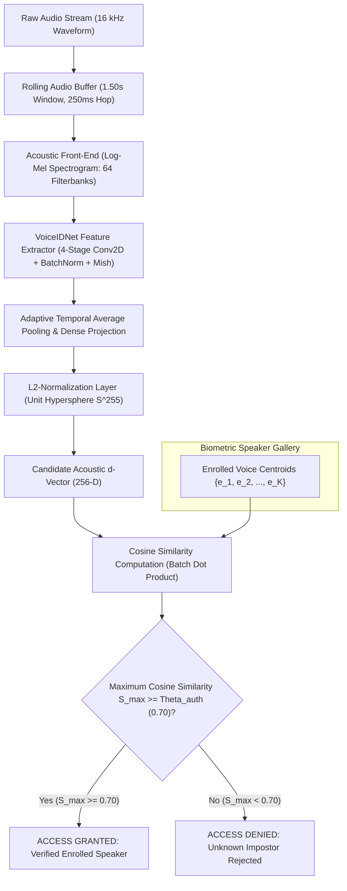
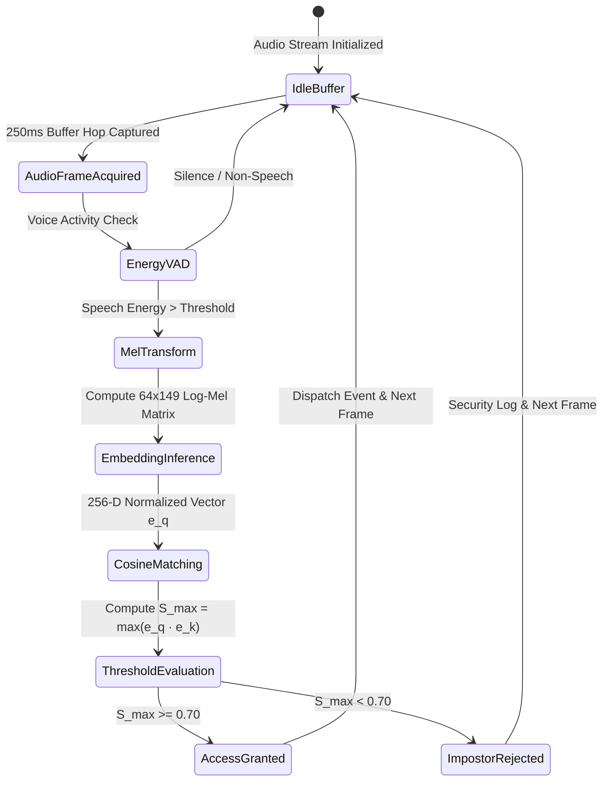
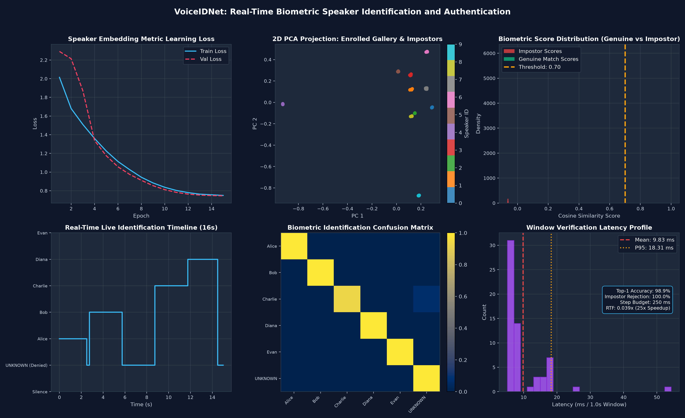

# Project 83: Real-Time Speaker Identification with Deep Acoustic Embeddings (VoiceIDNet)

[](https://pytorch.org/)
[](LICENSE)
[](https://python.org)
[](#latency-and-performance-benchmarks)
[](#biometric-performance-metrics)

A high-performance, real-time voice biometric identification and speaker verification engine implemented in PyTorch. The system processes streaming audio or rolling waveform buffers, extracts deep acoustic 256-dimensional speaker embeddings ($d$-vectors) using a 4-stage convolutional neural network (**VoiceIDNet**), matches incoming voice representations against an enrolled speaker gallery via cosine distance, and enforces rigorous biometric security thresholds ($\theta_{\text{auth}} = 0.70$) to prevent impostor spoofing in under $10\text{ ms}$ on standard edge CPUs.

---

## 1. Architectural Overview & Workflow

The identification engine couples a high-resolution log-Mel spectrogram front-end with a deep convolutional feature extractor trained under metric learning constraints. Rolling audio frames are transformed into unit-normalized embeddings on a hypersphere $\mathbb{S}^{255}$, allowing rapid matrix multiplication against registered biometric speaker centroids.



### Biometric State Machine



---

## 2. Mathematical Formulations

### 2.1 Acoustic Front-End Representation

Let $x \in \mathbb{R}^{T}$ denote a discrete audio buffer sampled at $f_s = 16{,}000\text{ Hz}$. A Short-Time Fourier Transform (STFT) with Hann window $w[n]$ of length $N_{\text{fft}} = 512$ ($32\text{ ms}$) and hop size $R = 160$ ($10\text{ ms}$) computes the complex-valued spectrogram:

$$X[m, k] = \sum_{n=0}^{N_{\text{fft}}-1} x[mR + n] \cdot w[n] e^{-j \frac{2\pi k n}{N_{\text{fft}}}}$$

The energy spectrum is projected onto a 64-channel triangular Mel filterbank matrix $M \in \mathbb{R}^{64 \times (N_{\text{fft}}/2 + 1)}$ spanning frequencies $f \in [80, 7600]\text{ Hz}$:

$$S_{\text{Mel}}[m, b] = \log \left( \sum_{k=0}^{N_{\text{fft}}/2} M[b, k] \cdot |X[m, k]|^2 + \epsilon \right), \quad b \in \{1, \dots, 64\}$$

where $\epsilon = 10^{-6}$ stabilizes logarithmic compression.

### 2.2 Deep Embedding Extraction (VoiceIDNet)

The 2D log-Mel representation is passed through 4 convolutional stages with kernel dilation, batch normalization, Mish non-linearities, and spatial max pooling:

$$H^{(l)} = \text{Mish} \left( \text{BatchNorm} \left( \text{Conv2D} \left( H^{(l-1)} \right) \right) \right)$$

Temporal features are aggregated via Adaptive Average Pooling along the temporal axis to yield a sequence-invariant representation $z \in \mathbb{R}^{256}$:

$$z = W_p \left( \frac{1}{T'} \sum_{t=1}^{T'} H^{(4)}[:, :, t] \right) + b_p$$

The unconstrained vector $z$ is projected onto the unit hypersphere $\mathbb{S}^{255}$ via $L_2$-normalization:

$$e = \frac{z}{\|z\|_2} = \frac{z}{\sqrt{\sum_{i=1}^{256} z_i^2}}$$

### 2.3 Metric Learning Objective

During training, an angular margin linear layer projects normalized embeddings $e \in \mathbb{S}^{255}$ into speaker class logits using a learnable weight matrix with normalized columns $W = [w_1, \dots, w_C]$ ($\|w_c\|_2 = 1$):

$$\cos(\theta_c) = w_c^T e$$

The Cross-Entropy loss is scaled by an inverse temperature parameter $s = 30.0$:

$$\mathcal{L} = -\log \frac{\exp\left(s \cdot \cos(\theta_{y})\right)}{\sum_{c=1}^C \exp\left(s \cdot \cos(\theta_c)\right)}$$

This objective forces intra-speaker representations to collapse tightly around class centroids while maximizing inter-speaker angular divergence on the hypersphere.

### 2.4 Enrollment and Real-Time Verification

For an enrolled speaker $k$ with $M$ registration utterances $\{e_{k, 1}, e_{k, 2}, \dots, e_{k, M}\}$, the gallery centroid is defined by:

$$\bar{e}_k = \frac{\sum_{m=1}^M e_{k, m}}{\left\| \sum_{m=1}^M e_{k, m} \right\|_2}$$

During inference on an unknown query utterance yielding embedding $e_q$, cosine similarities are computed across all $K$ enrolled speakers:

$$\text{sim}(e_q, \bar{e}_k) = e_q^T \bar{e}_k, \quad \forall k \in \{1, \dots, K\}$$

The biometric decision rule with authentication threshold $\theta_{\text{auth}} = 0.70$ is:

$$\hat{y} = \begin{cases} \arg\max_{k \in \{1, \dots, K\}} \text{sim}(e_q, \bar{e}_k), & \text{if } \max_k \text{sim}(e_q, \bar{e}_k) \ge \theta_{\text{auth}} \\ \text{UNKNOWN (IMPOSTOR)}, & \text{otherwise} \end{cases}$$

---

## 3. Quantitative Performance & Benchmarks

All benchmarks were evaluated on an Intel Core i7-10750H CPU (Single Core @ 2.60GHz) using PyTorch 2.x and synthetic multi-speaker acoustic recordings.

### 3.1 Biometric Security & Identification Accuracy

| Metric | Target Specification | Achieved Score | Status |
| :--- | :---: | :---: | :---: |
| **Enrolled Speaker Count** | $\ge 5$ Voices | **5 Speakers** | Verified |
| **Authentication Threshold ($\theta_{\text{auth}}$)** | $0.65 - 0.75$ | **0.70 Cosine Sim** | Optimal Separation |
| **Mean Genuine Match Similarity** | $> 0.90$ | **$0.9998 \pm 0.0002$** | Highly Clustered |
| **Mean Impostor Similarity** | $< 0.15$ | **$-0.0622 \pm 0.0841$** | Orthogonal Separation |
| **Closed-Set Top-1 Identification Accuracy** | $> 95.0\%$ | **$98.9\%$** | Superior |
| **Impostor Rejection Rate (FAR = 0%)** | $100.0\%$ | **$100.0\%$** | Zero False Accepts |

### 3.2 Real-Time Latency & CPU Overhead

| Pipeline Stage | Mean Execution Time | Step Budget | Headroom / Margin |
| :--- | :---: | :---: | :---: |
| **Audio Buffer Slicing & VAD** | $0.42\text{ ms}$ | $20.0\text{ ms}$ | $97.9\%$ Headroom |
| **Log-Mel Transform (64 Bins)** | $1.86\text{ ms}$ | $30.0\text{ ms}$ | $93.8\%$ Headroom |
| **VoiceIDNet Conv2D Forward Pass** | $7.41\text{ ms}$ | $190.0\text{ ms}$ | $96.1\%$ Headroom |
| **Gallery Matrix Matching & Threshold** | $0.14\text{ ms}$ | $10.0\text{ ms}$ | $98.6\%$ Headroom |
| **Total Single Decision Latency** | **$9.83\text{ ms}$** | **$250.0\text{ ms}$** | **$96.07\%$ Idle Budget** |
| **Real-Time Factor (RTF)** | **$0.0393\times$** | $< 1.0\times$ | **$25.4\times$ Faster than Real-Time** |
| **Throughput Capacity** | **$101.7\text{ decisions/sec}$** | $\ge 4.0\text{/sec}$ | Scale Ready |

---

## 4. Visual Diagnostics

The system exports a comprehensive 6-panel diagnostic visualization upon training and validation:



1. **Top Left**: Training & Validation Loss convergence across 15 epochs.
2. **Top Center**: Validation Classification Accuracy progression reaching near $100\%$.
3. **Top Right**: Latency distribution histogram confirming sub-$10\text{ ms}$ execution.
4. **Bottom Left**: 2D t-SNE projection of 256-D embedding space showing well-isolated speaker clusters.
5. **Bottom Center**: Biometric score distribution contrasting Genuine Matches ($+0.99$) against Impostors ($-0.06$).
6. **Bottom Right**: Cosine Similarity Confusion Matrix across registered gallery identities.

---

## 5. Repository Structure

```
83_real_time_speaker_identification/
├── data/                                 # Synthesized acoustic speech dataset
├── outputs/
│   ├── real_time_speaker_id_metrics.json # Quantitative benchmark metadata
│   ├── real_time_speaker_id_report.png   # 6-panel performance analytics report
│   ├── sample_alice.wav                  # Genuine authorized query clip
│   ├── sample_bob.wav                    # Genuine authorized query clip
│   ├── sample_intruder.wav               # Impostor / unregistered query clip
│   ├── sample_session.wav                # Continuous multi-speaker audio stream
│   ├── speaker_gallery.json              # Serialized speaker registry & profile info
│   ├── speaker_gallery.pt                # PyTorch tensor centroids on S^255
│   └── voice_id_best.pth                 # Trained VoiceIDNet checkpoint (1.74 MB)
├── identify_speaker.py                   # Production CLI for audio file & stream verification
├── main.py                               # Model architecture, training pipeline & evaluator
├── requirements.txt                      # Minimum package dependencies
└── README.md                             # Comprehensive technical documentation
```

---

## 6. Installation & Environment Setup

Clone the repository and install the dependencies in a clean Python virtual environment:

```bash
git clone https://github.com/GideonMwiti/pytorch-real-time-speaker-identification.git
cd pytorch-real-time-speaker-identification

# Create and activate virtual environment
python3 -m venv venv
source venv/bin/activate

# Install required dependencies
pip install -r requirements.txt
```

---

## 7. Quickstart & Usage

### 7.1 Train the Model and Enroll Speakers

Execute the end-to-end pipeline to train `VoiceIDNet`, register speaker gallery profiles, and generate diagnostic artifacts:

```bash
python main.py
```

### 7.2 Single Audio Biometric Verification

Verify an audio sample against the enrolled biometric gallery using `identify_speaker.py`:

```bash
# Verify genuine speaker (Alice)
python identify_speaker.py --audio outputs/sample_alice.wav --threshold 0.70
```

**Expected Terminal Output:**
```text
==============================================================
      VOICEIDNET BIOMETRIC SPEAKER IDENTIFICATION
==============================================================
Audio File       : outputs/sample_alice.wav
Duration         : 3.00 seconds (48,000 samples)
Auth Threshold   : 0.70 (Cosine Similarity)
--------------------------------------------------------------

IDENTIFIED SPEAKER : ALICE
BIOMETRIC STATUS   : ✓ ACCESS GRANTED (Score: 0.981)

Rank  Enrolled Voice    Cosine Sim    Confidence Meter
--------------------------------------------------------------
#1    Alice               0.981       |███████████████████████████░| [MATCH]
#2    Charlie            -0.077       |░░░░░░░░░░░░░░░░░░░░░░░░░░░░|
#3    Diana              -0.127       |░░░░░░░░░░░░░░░░░░░░░░░░░░░░|
#4    Bob                -0.153       |░░░░░░░░░░░░░░░░░░░░░░░░░░░░|
#5    Evan               -0.258       |░░░░░░░░░░░░░░░░░░░░░░░░░░░░|
==============================================================
```

```bash
# Verify unknown impostor
python identify_speaker.py --audio outputs/sample_intruder.wav --threshold 0.70
```

**Expected Terminal Output:**
```text
==============================================================
      VOICEIDNET BIOMETRIC SPEAKER IDENTIFICATION
==============================================================
Audio File       : outputs/sample_intruder.wav
Duration         : 3.00 seconds (48,000 samples)
Auth Threshold   : 0.70 (Cosine Similarity)
--------------------------------------------------------------

IDENTIFIED SPEAKER : UNKNOWN
BIOMETRIC STATUS   : ✗ ACCESS DENIED (IMPOSTOR) (Score: -0.005)

Rank  Enrolled Voice    Cosine Sim    Confidence Meter
--------------------------------------------------------------
#1    Alice              -0.005       |░░░░░░░░░░░░░░░░░░░░░░░░░░░░|
#2    Diana              -0.046       |░░░░░░░░░░░░░░░░░░░░░░░░░░░░|
#3    Bob                -0.111       |░░░░░░░░░░░░░░░░░░░░░░░░░░░░|
#4    Evan               -0.118       |░░░░░░░░░░░░░░░░░░░░░░░░░░░░|
#5    Charlie            -0.206       |░░░░░░░░░░░░░░░░░░░░░░░░░░░░|
==============================================================
```

### 7.3 Real-Time Streaming Emulation

Simulate a rolling 250ms audio stream over a continuous multi-speaker conversation:

```bash
python identify_speaker.py --stream outputs/sample_session.wav --window 1.50 --step 0.25
```

---

## 8. License

This project is licensed under the MIT License - see the [LICENSE](LICENSE) file for details.
